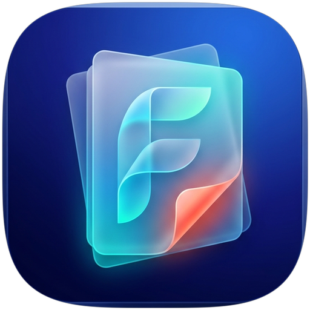

<p align="center">
  
</p>

<h1 align="center">Folio — Modern PDF Reader</h1>

<p align="center">
  <strong>Minimalist, akıcı ve yüksek performanslı çok platformlu PDF okuyucu.</strong>
</p>

<p align="center">
  
  
  
  
</p>

---

## 📖 Genel Bakış

**Folio**, modern tasarım prensipleri ve yüksek okuma performansı hedeflenerek Flutter ve Google Chromium'un endüstri standardı **PDFium** motoru üzerinde inşa edilmiş yeni nesil bir PDF okuyucudur. 

Masaüstünde (macOS, Windows) çok sekmeli verimli bir çalışma alanı sunarken, mobilde (Android) dokunmatik ekranlara ve sistem paylaşımlarına optimize edilmiş hafif ve akıcı bir deneyim sağlar.

---

## ✨ Temel Özellikler

### 📑 Çoklu Sekme Desteği (Multi-Tab Browsing)
* Aynı pencerede birden fazla PDF dokümanını sekmeler halinde açabilir, aralarında gecikmesiz geçiş yapabilirsiniz.
* Her sekme kendi sayfa konumunu, yakınlaştırma oranını ve arama geçmişini bağımsız olarak saklar.

### 🔍 Canlı ve Etkileşimli Metin Arama (Text Search)
* **Kısayol:** `⌘ + F` (macOS) / `Ctrl + F` (Windows / Linux).
* Belge genelinde eşleşen tüm kelimeler sayfa üzerinde otomatik vurgulanır (highlight).
* Eşleşme sayacı (`1 / 14`) ve yukarı/aşağı butonları (`Enter` / `Shift + Enter`) ile sonuçlar arasında anında gezinme.
* Seçilen eşleşmeye ve sayfaya otomatik kaydırma (`auto-scroll`).

### 🛠️ Gelişmiş Dosya İşlemleri
* **Farklı Kaydet (Save As):** Dokümanı dilediğiniz isimle yeni bir konuma kopyalama.
* **Taşı (Move):** Dosyayı cihaz üzerinde farklı bir klasöre aktarma.
* **Yeniden Adlandır (Rename):** Uygulamadan çıkmadan dosya adını güncelleme ve sekmeyi eşleme.
* **Dosya Detayları (Document Info):** Boyut, oluşturulma/düzenlenme tarihi ve dosya yolu görüntüleme.

### 📤 Yerel Paylaşım (Native Share)
* Hem Android hem macOS üzerinde sistem paylaşım menüsü entegrasyonu.
* Belgeleri doğrudan WhatsApp, Telegram, Gmail, AirDrop, Mail veya Bluetooth üzerinden gönderebilme.

### ⚡ Üstün Okuma & Görsel Deneyim
* **Genişliğe Sığdır (Auto-fit Width):** Belge açıldığında okuma kolaylığı için ekran genişliğine otomatik hizalama.
* **Kademeli Yakınlaştırma (Stepped Zoom):** Ani sıçramalar olmadan %100, %125, %150 gibi düzenli oranlarla akıcı yakınlaştırma.
* **Sürüklenebilir Kaydırma Çubuğu (Scroll Thumb):** Hızlı kaydırma yaparken mevcut sayfa numarasını gösteren dinamik sayfa balonu.
* **Küçük Resimler Kenar Çubuğu (Thumbnails):** `⌘ + B` ile açılabilen sol önizleme paneli.
* **Açık & Koyu Tema:** Sistem temasına uyumlu veya manuel geçiş yapılabilen modern koyu mod desteği.

### 🔗 İşletim Sistemi Entegrasyonları
* **macOS:** Finder üzerinden *"Birlikte Aç (Open With)"*, Dock simgesine sürükleyip bırakma ve AppleEvents yönlendirmesi.
* **Android:** Dosya yöneticisi, WhatsApp veya e-postadan gelen PDF'leri tek tıkla doğrudan açma (`ACTION_VIEW` ve `ACTION_SEND` Intent desteği).

---

## ⌨️ Klavye Kısayolları

| Kısayol (macOS) | Kısayol (Windows) | İşlem |
| :--- | :--- | :--- |
| <kbd>⌘ + O</kbd> | <kbd>Ctrl + O</kbd> | PDF Dosyası Seç ve Aç |
| <kbd>⌘ + F</kbd> | <kbd>Ctrl + F</kbd> | Belge İçi Arama Çubuğunu Aç / Kapat |
| <kbd>⌘ + W</kbd> | <kbd>Ctrl + W</kbd> | Aktif Sekmeyi Kapat |
| <kbd>⌘ + B</kbd> | <kbd>Ctrl + B</kbd> | Sayfa Önizleme Çubuğunu (Thumbnails) Aç / Kapat |
| <kbd>⌘ + Tab</kbd> | <kbd>Ctrl + Tab</kbd> | Sonraki Sekmeye Geç |
| <kbd>⌘ + Shift + Tab</kbd> | <kbd>Ctrl + Shift + Tab</kbd> | Önceki Sekmeye Geç |
| <kbd>⌘ + +</kbd> / <kbd>⌘ + =</kbd> | <kbd>Ctrl + +</kbd> / <kbd>Ctrl + =</kbd> | Yakınlaştır (Zoom In) |
| <kbd>⌘ + -</kbd> | <kbd>Ctrl + -</kbd> | Uzaklaştır (Zoom Out) |
| <kbd>⌘ + 0</kbd> | <kbd>Ctrl + 0</kbd> | Genişliğe Sığdır (Fit Width) |
| <kbd>Enter</kbd> | <kbd>Enter</kbd> | Sonraki Arama Eşleşmesi |
| <kbd>Shift + Enter</kbd> | <kbd>Shift + Enter</kbd> | Önceki Arama Eşleşmesi |
| <kbd>Esc</kbd> | <kbd>Esc</kbd> | Aramayı Kapat |
| <kbd>←</kbd> / <kbd>→</kbd> | <kbd>←</kbd> / <kbd>→</kbd> | Önceki / Sonraki Sayfa |

---

## 🛠️ Mimari & Teknolojiler

* **Kullanıcı Arayüzü:** [Flutter](https://flutter.dev/) 3 (Material Design 3 & macOS Human Interface uyumlu arayüz)
* **PDF Render Motoru:** [`pdfrx`](https://pub.dev/packages/pdfrx) & **Google PDFium**
* **Dosya İletişimi & Seçici:** [`file_picker`](https://pub.dev/packages/file_picker) & Native Platform Channels (Swift / Kotlin)
* **Veri Paylaşımı:** AndroidX `FileProvider` ve macOS `NSSharingServicePicker`

---

## 🚀 Kurulum ve Derleme

### Gereksinimler
* [Flutter SDK](https://docs.flutter.dev/get-started/install) (3.24+)
* **macOS için:** Xcode & CocoaPods
* **Android için:** Android Studio & JDK 17+

### Projeyi Çalıştırma
```bash
# Depoyu klonlayın
git clone https://github.com/mozdemir90/folio.git
cd folio

# Bağımlılıkları indirin
flutter pub get

# macOS üzerinde çalıştırın
flutter run -d macos

# Android cihaz/emülatörde çalıştırın
flutter run -d android
```

### Dağıtım Paketleri Oluşturma (Release)

* **macOS Release Uygulaması:**
  ```bash
  flutter build macos --release
  # Çıktı: build/macos/Build/Products/Release/Folio.app
  ```

* **Android APK:**
  ```bash
  flutter build apk --release
  # Çıktı: build/app/outputs/flutter-apk/app-release.apk
  ```

* **Android App Bundle (Google Play Store):**
  ```bash
  flutter build appbundle --release
  # Çıktı: build/app/outputs/bundle/release/app-release.aab
  ```

---

## 📄 Lisans & Yasal Bilgiler

Bu proje **[MIT Lisansı](LICENSE)** ile lisanslanmıştır. Projede kullanılan tüm harici kütüphaneler (Google PDFium, pdfrx, Flutter, AndroidX) açık kaynaklı ve ticari kullanıma uygun (MIT, BSD-3, Apache 2.0) lisanslara sahiptir; copyleft kısıtlaması içermez.

* [Açık Kaynak Lisans Bilgileri](docs/legal/ACIK_KAYNAK_LISANSLARI.md)
* [Gizlilik Politikası (Privacy Policy)](docs/legal/GIZLILIK_POLITIKASI.md)
* [Kullanıcı Sözleşmesi (Terms of Service)](docs/legal/KULLANICI_SOZLESMESI.md)
* [KVKK Aydınlatma Metni](docs/legal/KVKK_AYDINLATMA_METNI.md)
